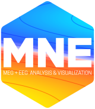
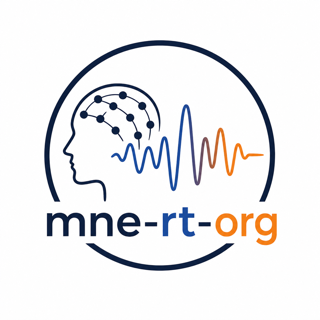

Software and tools I've built or maintained for neuroscience research:
neurofeedback, real-time BCI, multi-modal recording, and connectivity analysis.

  

    
    

      <h3 class="project__title"><a href="https://mne-rt-org.github.io/mne-rt/">MNE-RT</a></h3>
      

        A high-level neurofeedback and BCI framework built on top of
        <a href="https://mne.tools">MNE-Python</a> and
        <a href="https://mne.tools/mne-lsl/stable/index.html">MNE-LSL</a>.
        It provides the complete closed-loop pipeline: sensor- and source-space feature extraction,
        adaptive neurofeedback protocols, online artifact correction, real-time visualisation,
        feature combination, OSC and LSL output, BIDS-compatible session saving, and a
        comprehensive command-line interface.
      

    

  

  

    
    

      <h3 class="project__title"><a href="https://mne.tools">MNE-Python</a> Maintainer</h3>
      

        An open-source Python package for exploring, visualizing, and analyzing human
        neurophysiological data (MEG, EEG, sEEG, ECoG, fNIRS, and more). As a member of the
        maintainer team, I contribute to core maintenance, code reviews, bug fixes, and feature
        development across the MNE ecosystem.
      

    

  

  

    
    

      <h3 class="project__title"><a href="https://github.com/fcbg-platforms/mosaic">MOSAIC</a></h3>
      

        A synchronized multi-camera and audio recording suite for research labs, built around Basler
        GigE cameras, with live pose/gaze preview, post-recording analysis, and Lab Streaming Layer
        (LSL) integration for syncing with external systems such as EEG.
      

    

  

  

    
    

      <h3 class="project__title"><a href="https://github.com/payamsash/antares">ANTARES</a></h3>
      

        A closed-loop EEG neurofeedback system developed for tinnitus research. It runs an adaptive
        multi-session protocol that automatically selects the most informative EEG feature for each
        participant, monitors feature quality across sessions, and adjusts the training target when
        necessary. It comes with a single-GUI operator interface, a separate full-screen participant
        display, and a real-time neurofeedback visualisation engine.
      

    

  

